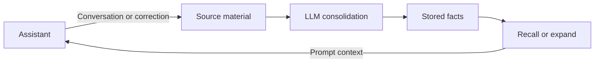

# atom-memory

[简体中文](README.zh-CN.md)

An HTTP service for long-term memory in AI assistants. It stores source material, uses an LLM to turn it into short facts, and retrieves those facts within a character budget.

I built it as the memory backend for [Velora](https://github.com/CY202227/Velora). It runs as a separate process, so other applications can use the same API.

## How it works



A **source** is the original material: a conversation, correction, diary entry, or document. An **atom** is a stored fact with a short `statement` and an optional `detail`. Consolidation creates or updates atoms and records their revisions and supporting sources.

The assistant normally receives statements rather than full conversations. It can request details with `expand` when needed. Statements are capped at 80 characters and details at 300 characters; these limits suit short facts better than long documents.

Each `space` has its own sources and atoms. Corrections can update an existing fact, revisions can be rolled back, and sources can be deleted by their upstream reference.

## Run locally

Requires Python 3.11 or later. Consolidation needs an OpenAI-compatible chat endpoint. BM25 and fuzzy recall do not need an LLM.

**Windows (PowerShell)**

```powershell
python -m venv .venv
.\.venv\Scripts\python.exe -m pip install -e ".[dev]"
Copy-Item .env.example .env
```

**macOS / Linux**

```sh
python3 -m venv .venv
.venv/bin/python -m pip install -e ".[dev]"
cp .env.example .env
```

Set the model connection in `.env`:

```dotenv
ATOMMEM_DATABASE_URL=sqlite:///./atom_memory.db
ATOMMEM_LLM_BASE_URL=http://127.0.0.1:8000/v1
ATOMMEM_LLM_API_KEY=EMPTY
ATOMMEM_LLM_MODEL=your-model
```

Use your provider's endpoint, key, and model name. Start the service with the virtual environment's Python:

```powershell
# Windows
.\.venv\Scripts\python.exe -m uvicorn atom_memory.main:app --host 127.0.0.1 --port 8020
```

```sh
# macOS / Linux
.venv/bin/python -m uvicorn atom_memory.main:app --host 127.0.0.1 --port 8020
```

Open [API docs](http://127.0.0.1:8020/docs), [stored memories](http://127.0.0.1:8020/ui), or the [chat demo](http://127.0.0.1:8020/chat). The demo can save memories when its write option is enabled. `/health` checks that the service is running.

## Connect an assistant

The application controls when to write and consolidate memory:

1. Call `POST /spaces` to create a space.
2. Before answering, call `POST /spaces/{uid}/recall` and add its `context_block` to the prompt.
3. After answering, send material worth keeping to `POST /spaces/{uid}/sources`.
4. Call `POST /spaces/{uid}/consolidate` periodically, or immediately after a correction.
5. Use `POST /spaces/{uid}/atoms/expand` when a statement lacks enough detail.

For a correction, send `kind=correction` with a high `salience`, such as `0.9`. A successful consolidation run does not necessarily mean that correction was consumed: check its source status before telling the user it was remembered.

Use an `idempotency_key` when retrying source writes. The application should persist the material and key before sending; atom-memory cannot recover a request it never received.

Velora connects through `VELORA_ATOM_MEMORY_BASE_URL`. Its repository includes a Compose setup that starts both services. This repository does not yet include a standalone Docker setup.

See the [API contract](docs/contract.md) for request fields, source deletion, and memory layers, and the [upgrade guide](docs/upgrade-and-delivery.md) for database migration and delivery recovery.

## Retrieval

- **BM25** is the default for matching words and phrases.
- **Fuzzy** recall helps with approximate text matches.
- **LLM** recall asks the configured model to select relevant memories and adds a model call.
- **Embedding** recall uses a configured embedding endpoint; **hybrid** combines it with BM25.

`budget_chars` limits the recalled content. The default is 400 characters with `detail=statement`; use `detail=full` or `expand` for additional context. The response includes `chars_used` and `atoms_clipped`. The character budget is not a token limit.

The default layered policy prioritizes stable profile facts (L3), then relevant summaries (L2), then individual facts (L1). `synthesize` and `persona` build the higher layers through separate API calls; the service does not schedule them itself.

## Storage and deployment

SQLite is the default. PostgreSQL is supported through `ATOMMEM_DATABASE_URL`; the migration path has SQLite regression coverage, but PostgreSQL still needs validation against a live database.

Set `ATOMMEM_API_KEY` to require the `X-API-Key` header. `owner_id` is a grouping label, not an authorization system. Runtime writes use a process-local lock, so run a single worker; multiple workers or instances need database-level coordination.

## Tests and evaluation

Run `python -m pytest tests -q` with the virtual environment's Python. Tests use scripted models to cover consolidation, corrections, recall, budgets, deletion, and database upgrades.

The repository also contains LoCoMo and PersonaMem evaluation runners. For an offline LoCoMo smoke test:

```sh
python -m atom_memory.eval.run_locomo --mini
```

The mini run uses oracle consolidation and checks retrieval. It is not a measure of real-model memory quality. No reproducible real-model benchmark report is published yet.

## License

[MIT](LICENSE)
