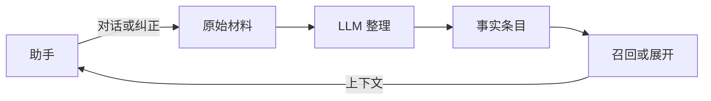

# atom-memory

[English](README.md)

为 AI 助手提供长期记忆的 HTTP 服务。保存原始材料，用 LLM 整理成短事实，再按字符预算召回。

这个项目最初是为 [Velora](https://github.com/CY202227/Velora) 做的记忆后端。它独立运行，其他应用也可以通过同一套 API 接入。

## 工作方式



**Source** 是对话、纠正、日记或文档等原始材料。**Atom** 是整理后的事实条目，包含简短的 `statement` 和可选的 `detail`。整理过程会新增或更新条目，并记录修订历史及其来源。

助手通常只收到短断言，需要更多信息时再通过 `expand` 展开。断言最多 80 字符，详情最多 300 字符；这个结构适合保存短事实，长文仍应保留在来源中。

每个 `space` 独立保存来源和事实。纠正可以更新已有条目，历史版本可以回滚，也可以按上游引用删除来源材料。

## 本地启动

需要 Python 3.11 或更高版本。整理记忆需要 OpenAI 兼容的聊天接口；BM25 和 fuzzy 召回不需要调用 LLM。

**Windows（PowerShell）**

```powershell
python -m venv .venv
.\.venv\Scripts\python.exe -m pip install -e ".[dev]"
Copy-Item .env.example .env
```

**macOS / Linux**

```sh
python3 -m venv .venv
.venv/bin/python -m pip install -e ".[dev]"
cp .env.example .env
```

在 `.env` 中配置模型连接：

```dotenv
ATOMMEM_DATABASE_URL=sqlite:///./atom_memory.db
ATOMMEM_LLM_BASE_URL=http://127.0.0.1:8000/v1
ATOMMEM_LLM_API_KEY=EMPTY
ATOMMEM_LLM_MODEL=your-model
```

将地址、密钥和模型名改成实际使用的值。用虚拟环境中的 Python 启动：

```powershell
# Windows
.\.venv\Scripts\python.exe -m uvicorn atom_memory.main:app --host 127.0.0.1 --port 8020
```

```sh
# macOS / Linux
.venv/bin/python -m uvicorn atom_memory.main:app --host 127.0.0.1 --port 8020
```

可打开 [API 文档](http://127.0.0.1:8020/docs)、[记忆预览](http://127.0.0.1:8020/ui)或[聊天调试页](http://127.0.0.1:8020/chat)。调试页开启写入选项后可以保存记忆；`/health` 用于检查服务是否运行。

## 接入助手

何时写入、何时整理，由上游应用决定：

1. 用 `POST /spaces` 创建记忆库。
2. 回答前调用 `POST /spaces/{uid}/recall`，将返回的 `context_block` 加入提示词。
3. 回答后将值得保存的材料写入 `POST /spaces/{uid}/sources`。
4. 定期调用 `POST /spaces/{uid}/consolidate`；用户明确纠正时立即调用。
5. 短断言不足以回答时，用 `POST /spaces/{uid}/atoms/expand` 获取详情。

纠正使用 `kind=correction` 和较高的 `salience`，例如 `0.9`。整理任务成功不一定代表这条纠正已被消费；应检查对应 Source 的状态，再告诉用户记忆已更新。

重试写入时使用相同的 `idempotency_key`。上游应先持久化材料和该键，再发送请求；服务无法补回从未收到过的材料。

Velora 通过 `VELORA_ATOM_MEMORY_BASE_URL` 连接记忆服务，其仓库已有同时启动两个服务的 Compose 配置。atom-memory 本仓库暂未提供独立 Docker 配置。

请求字段、按来源删除及记忆分层见 [API 契约](docs/contract.md)；数据库迁移与投递恢复见[升级说明](docs/upgrade-and-delivery.md)。

## 召回方式

- **BM25**：默认方式，按词和短语匹配。
- **Fuzzy**：用于近似文本匹配。
- **LLM**：让配置的模型选择相关记忆，会增加一次模型调用。
- **Embedding**：使用另行配置的向量接口；**hybrid** 将其与 BM25 结合。

`budget_chars` 限制召回内容的字符数，默认值为 400，默认只返回 `statement`。需要详情时使用 `detail=full` 或 `expand`。响应中的 `chars_used` 和 `atoms_clipped` 可用于检查预算；字符预算不等于 token 上限。

默认分层策略先选稳定画像（L3），再选相关综合（L2），最后补充具体事实（L1）。较高层记忆由独立的 `synthesize` 和 `persona` 接口生成，服务自身不安排定时执行。

## 存储与部署

默认使用 SQLite，也可通过 `ATOMMEM_DATABASE_URL` 配置 PostgreSQL。目前数据库迁移有 SQLite 回归测试，PostgreSQL 仍需实库验证。

设置 `ATOMMEM_API_KEY` 后，请求需要携带 `X-API-Key`。`owner_id` 只是分组标签，不提供用户权限隔离。运行时写入使用进程内锁，应部署为单 worker；多 worker 或多实例需要数据库级协调。

## 测试与评估

用虚拟环境中的 Python 运行 `python -m pytest tests -q`。测试使用预设模型回复，覆盖整理、纠正、召回、预算、删除和数据库升级。

仓库中还包含 LoCoMo 和 PersonaMem 评估程序。可以先运行离线 LoCoMo 冒烟测试：

```sh
python -m atom_memory.eval.run_locomo --mini
```

这个迷你测试使用 oracle 整理并检查检索结果，不代表真实模型的记忆质量。目前尚未发布可复现的真实模型评估报告。

## 许可证

[MIT](LICENSE)

来源查证提供词法检索和可选语义选择，返回有来源 ID 的历史原文片段；它与当前原子断言分开，明确较新的纠正优先。公开试点、失败记录与评分限制见[评测说明](docs/evaluation/README.md)。

可选的事实预提取试验：`ATOMMEM_CONSOLIDATE_EXTRACT_FACTS=true`。固化前列出原文引用，并校验这些引用在写入后仍被保留；失败不消费来源。默认关闭：公开试点保留了更多事实，但问答没有改善。[评测说明](docs/evaluation/README.md)保留了失败记录与对照结果。
